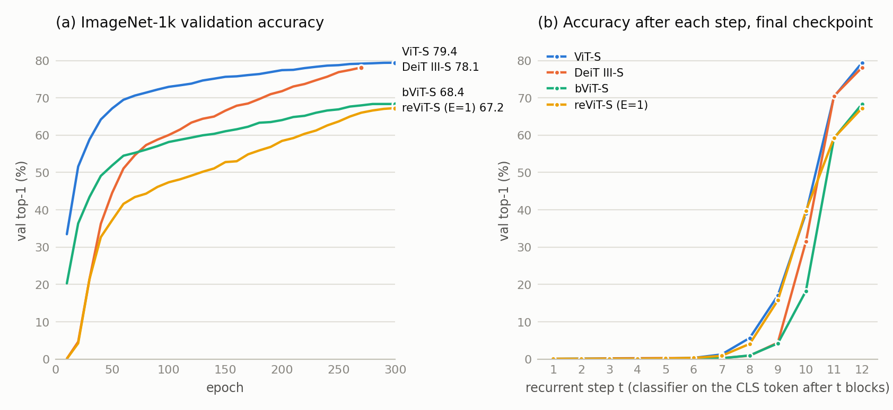

# recurrent-vit

**Single-block recurrent Vision Transformers in PyTorch: bViT and reViT, with their ViT / DeiT III baselines, trained from scratch on ImageNet-1k.**

[](LICENSE)


A standard ViT stacks *L* blocks, each with its own weights. A **recurrent** ViT keeps
*one* block and applies it *L* times, so computational depth no longer costs parameters.
This repository implements two recent takes on that idea in one small, readable codebase:

- **bViT** (Byra et al., 2026, [arXiv:2605.10661](https://arxiv.org/abs/2605.10661)): the
  whole network is a single transformer block looped *L* times. ViT-B accuracy within one
  point at a tenth of the parameters.
- **reViT** (Bulat et al., 2026, [arXiv:2610.12448](https://arxiv.org/abs/2610.12448)): the
  shared block's feed-forward layer is a bank of *E* experts whose **weights** are mixed at
  every step by a tiny router that only sees the depth. The block can change its behaviour
  with depth, and it still costs one FFN per token.

Both are one model class (`rvit.model.RecurrentViT`) and one config. Standard ViTs,
partial weight sharing and the papers' ablations are flag combinations of it.

<picture>
  <source media="(prefers-color-scheme: dark)" srcset="assets/results-dark.png">
  
</picture>

## Highlights

- **One block, many depths.** `depth` (block evaluations) and `n_blocks` (independent
  weight sets) are separate knobs: `n_blocks = depth` gives a ViT, `n_blocks = 1` a bViT,
  anything in between the papers' partial-sharing variants.
- **Depth-programmed experts.** `n_experts > 1` turns every FFN into a weight-merged expert
  bank with a depth router and the three reViT auxiliary losses. Diagnostics for expert
  collapse are logged as well.
- **Paper-exact model sizes.** Parameter counts match both papers. The unit tests check
  them.
- **Both training recipes.** bViT's torchvision-style recipe and reViT's shortened DeiT III
  recipe, selected with `--recipe`.
- **Built for shared clusters.** Streams ImageNet from parquet shards and uses DDP with
  gradient accumulation. Runs are resumable and save before a time limit, so a SLURM array
  of short jobs chains into one long run.
- **Accuracy after every step.** Evaluation reports top-1 with the classifier applied after
  each recurrent step (bViT Fig. 2a).

## Results

ImageNet-1k validation top-1 (%), 224 px, trained from scratch on 4× A100. Our numbers are
a **single seed** (best checkpoint of the run). Paper numbers are from Table 1 of each paper.

| Model | Params | Recipe | Paper | Ours |
|---|---:|---|---:|---:|
| ViT-S | 22.0 M | bViT | 78.2 ± 0.3 | **79.6** |
| bViT-S | 2.5 M | bViT | 68.1 ± 0.3 | **68.4** |
| DeiT III-S | 22.1 M | DeiT III | 79.9 | 78.1 † |
| reViT-S, *E* = 1 | 2.5 M | DeiT III | – | 67.3 |
| reViT-S, *E* = 4 | 6.1 M | DeiT III | 78.2 | in progress ‡ |

† Stopped at epoch 270 of 300 by a cluster failure.
‡ With the DeiT III recipe as published, our reViT-S *E* = 4 run collapsed: the experts
became copies of each other early on. With the bViT recipe it trains normally (45.4 % at
epoch 30, against 43.4 % for bViT-S at the same point) and is still running. See
[docs/results.md](docs/results.md) for the details and the collapse diagnostics.

## Installation

```bash
git clone https://github.com/Caglar05/recurrent-vit.git
cd recurrent-vit
pip install -e ".[dev]"      # torch, torchvision, timm, pyarrow, pillow, wandb (+ pytest, ruff)
pytest                       # 20 CPU tests, under a minute
```

Python ≥ 3.11 and PyTorch ≥ 2.4. Training uses bf16 autocast and `torch.compile` on CUDA,
and also runs on CPU for debugging.

## Data

| split | format | location |
|---|---|---|
| train | Hugging Face [`ILSVRC/imagenet-1k`](https://huggingface.co/datasets/ILSVRC/imagenet-1k) parquet shards (`train-*.parquet`, 1,281,167 images) | `--train_dir` or `$RVIT_TRAIN_DIR` |
| val | `ImageFolder`: one sub-directory per synset (`n01440764/`, …), 50,000 images | `--val_dir` or `$RVIT_VAL_DIR` |

The Hugging Face label ids follow sorted-synset order, the same order `ImageFolder` gives
the validation folders, so the two splits agree without any remapping.

## Quick start

```bash
export RVIT_TRAIN_DIR=/data/imagenet-1k/data RVIT_VAL_DIR=/data/imagenet-1k/val

# smoke test: 50 steps, 1,000 val images, no compilation
python -m rvit.train --model bvit-s --recipe bvit --run_name smoke \
    --max_steps 50 --val_limit 1000 --compile false --num_workers 4

# full bViT-S run on 4 GPUs (global batch 1024 = 4 x 256)
torchrun --standalone --nproc_per_node 4 -m rvit.train \
    --model bvit-s --recipe bvit --run_name bvit-s_s0 --wandb_project recurrent-vit

# reViT-S with 8 experts and the DeiT III recipe
torchrun --standalone --nproc_per_node 4 -m rvit.train \
    --model revit-s --recipe deit3 --model.n_experts 8 --run_name revit-s-e8
```

Each run writes `config.json`, `metrics.jsonl`, `last.pt` (full resume state) and `best.pt`
to `runs/<run_name>/`. Re-running the same command resumes it. For SLURM, copy
`slurm/site.env.example` to `slurm/site.env`, fill it in, and run
`MODEL=bvit-s RECIPE=bvit bash slurm/launch.sh`.
[docs/training.md](docs/training.md) explains every option.

## Models

`--model <family>-<size>` with size `s` / `b` / `l` (ViT-S/16, B/16, L/16):

| family | what it is | blocks | experts | norm | S / B / L params |
|---|---|---|---|---|---|
| `vit` | bViT paper's ViT baseline | *L* | 1 | RMSNorm | 22.0 / 86.6 / 304.3 M |
| `bvit` | one shared block | 1 | 1 | RMSNorm | 2.5 / 8.6 / 14.6 M |
| `revit` | shared block + depth-routed experts | 1 | 4 | LayerNorm | 6.1 / 22.8 / 39.8 M |
| `deit3` | reViT paper's baseline (LayerScale, drop-path) | *L* | 1 | LayerNorm | 22.1 / 86.6 / 304.4 M |

Any field can be overridden with `--model.<field>`. For example, `--model.n_blocks 2` gives
bViT's "(2B, 6S)" partial sharing, `--model.step_embed true` gives bViT-TE, and
`--model.n_experts 8` the reViT expert sweep. See [docs/methods.md](docs/methods.md) for
the math.

## Documentation

- [docs/methods.md](docs/methods.md): the model, the two papers' mechanisms, the auxiliary
  losses and the implementation choices the papers leave open.
- [docs/training.md](docs/training.md): CLI, recipes, every option, outputs, resuming,
  SLURM.
- [docs/results.md](docs/results.md): full results, per-step accuracy, reViT training
  stability, throughput.

## Repository layout

```
rvit/
  model.py     RecurrentViT: shared blocks, expert FFN bank, depth router, aux losses, presets
  config.py    TrainConfig, the two recipes, the flat CLI
  data.py      parquet streaming loader, bViT / DeiT III augmentations, val ImageFolder
  train.py     DDP training loop: resume, EMA, per-step evaluation, logging
slurm/         chunked SLURM launcher (+ site.env.example for cluster settings)
scripts/       plot_results.py: the figure above, from a runs directory
tests/         parameter counts vs. papers, weight merging, router, data stream, CLI
docs/          methods, training guide, detailed results
```

## Citation

This is an independent re-implementation and is not affiliated with the authors of
either paper. If you use it, please cite the papers:

```bibtex
@article{byra2026bvit,
  title   = {Investigating Single-Block Recurrence in Vision Transformers for Image Recognition},
  author  = {Byra, Michal and Olszowiec, Pawel and Stefanski, Grzegorz and Gruszczynski, Grzegorz and Presta, Alberto},
  journal = {arXiv preprint arXiv:2605.10661},
  year    = {2026}
}

@article{bulat2026revit,
  title   = {One Block, Multiple Depths: Recurrent Vision Transformers with Depth-Programmed Experts},
  author  = {Bulat, Adrian and Ouali, Yassine and Tzimiropoulos, Georgios},
  journal = {arXiv preprint arXiv:2610.12448},
  year    = {2026}
}
```

To cite this code, use GitHub's "Cite this repository" button (see
[CITATION.cff](CITATION.cff)).

## License

[MIT](LICENSE)
